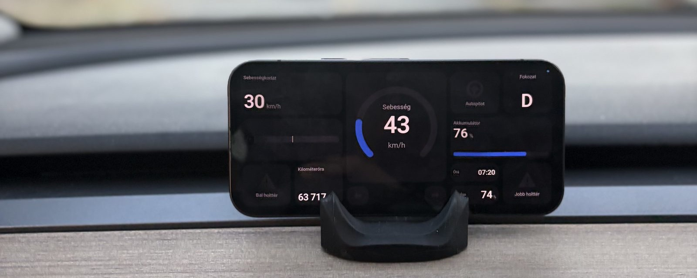

# DashPilot



A companion app for [DashKit](https://github.com/softwiredtech/dashkit-firmware), an open-source controller for Teslas.

DashKit plugs into the car and streams live car data to your phone over Bluetooth Low Energy. DashPilot turns it into a real-time dashboard: speed, gear, blinkers, blind spots, cruise set speed, speed limit, battery and more. Through DashKit it can also control the car (frunk, trunk, charge port, mirrors, climate) and run automations like keeping the climate on after you leave.

Supported cars: Tesla Model 3 / Model Y (2019–2024) and Model Y Juniper (2025+).

Get it on [Google Play](https://play.google.com/store/apps/details?id=com.softwiredtech.dashpilot) or [TestFlight](https://testflight.apple.com/join/hXTwZmh5), and join us on [Discord](https://discord.gg/naTZgwVqvA).

## Dash apps

The dashboards are dash apps: a web app (HTML, CSS, JavaScript) or a [Rive](https://rive.app) file. You can write your own. The [dash-apps README](./dash-apps/README.md) describes the data they receive, and the built-in dashboards are working examples.

To try yours on a phone, open Settings → Developer: **Load Rive File**, or **Load dash app from URL** for a web app served from your computer. Set the data source to **Demo** on the home screen to get simulated driving data without a car.

🏆 **[Dash App Contest](./dash-apps/contest/README.md)**: build a dashboard and win $250. Submissions are open until October 30.

## Data sources

- **DashKit**: the main one, over Bluetooth Low Energy.
- **Demo**: a loop of simulated driving, built into the app.
- **comma**: reads the car through a [comma](https://comma.ai) device running openpilot. It works, but it isn't actively maintained.
- **WebSocket**: reads car data from your own server, handy for feeding recorded or generated drives. Android debug builds only.

### WebSocket data source

The app connects as a client to `ws://<ip>:8080`, where `<ip>` is the address you enter in the app. The port is fixed. Your server sends one JSON object per message, as often as it likes, each one a full snapshot of the car state using the [CarState](./dash-apps/README.md#carstate) keys. Keys you leave out read as `0` / `false`. Send metric values (odometer in km, temperatures in °C, speed limit in km/h): the app converts them when the user picks imperial units. `egoSpeed` and `accSetSpeed` are shown as-is.

```json
{ "egoSpeed": 87, "gear": 4, "leftBlinker": 2, "adasOn": true, "accSetSpeed": 90, "fusedSpeedLimit": 90 }
```

## Repo structure

| folder | |
|---|---|
| [`dashpilot-android/`](./dashpilot-android/) | Android app (Kotlin, Jetpack Compose) |
| [`dashpilot-ios/`](./dashpilot-ios/) | iOS app (SwiftUI) |
| [`dash-apps/`](./dash-apps/) | the built-in dashboards, and the contest |
| [`bridge/`](./bridge/) | C++ car connection and CAN decoding used by the comma data source, see its [README](./bridge/README.md) |
| [`scripts/`](./scripts/) | copy the dash apps into the Android and iOS builds |

The DashKit firmware lives in its own repo: [softwiredtech/dashkit-firmware](https://github.com/softwiredtech/dashkit-firmware).

## Building

- **Android:** open `dashpilot-android` in Android Studio and run. The dash apps are copied into the app automatically before each build.
- **iOS:** open `dashpilot-ios/dashpilot.xcodeproj` in Xcode and run. An Xcode build phase copies the dash apps.

## Contributing

We're looking for bug fixes, performance improvements, good tests, and new dash apps.

- Make your first PR a small bugfix or improvement. Don't submit a big change if you haven't contributed yet.
- Keep PRs small and isolated: never mix conceptually different changes in one PR. If a large change is conceptually one thing, still split it up and note in each PR which ones it depends on.
- Using AI tools is fine *as long as you understand every line you submit*. If it's clear during review that you don't understand the change, the PR will be closed.
- Start the PR title with the part of the stack it touches, e.g. `[android]`, `[ios]`, `[dash-apps]` or `[bridge]`.
