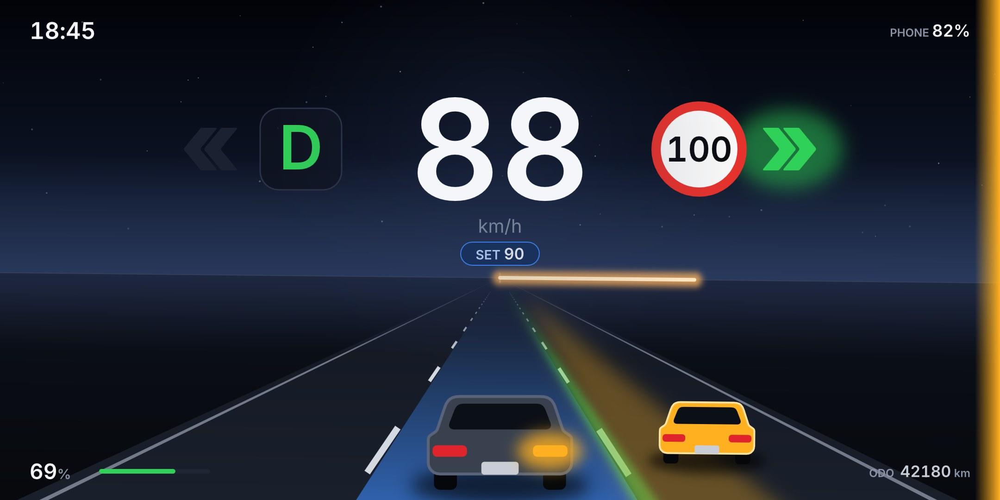

# Horizon

**Category:** Rive
**File:** [`horizon.riv`](horizon.riv) (about 90 KB), built from [`src/`](src/)

Horizon is a night drive. Your speed sits large in the sky, and the car's data shows up in the road scene around it. Lane markings flow toward you at the speed you're driving. The horizon tilts slightly with the steering wheel, like an aircraft attitude indicator, and the horizon line doubles as the power meter: warm light to the right under power, green to the left under regen. Turn signals light the lane line you're about to cross and the matching tail light on your car. A car in your blind spot appears in the next lane: amber for a vehicle, red when it's urgent. A traffic light washes the sky red, amber or green, and the stop line slides toward you as you approach it. With driver assist on, your lane gets a blue carpet (orange in experimental mode). Nothing else on screen competes with the speed.

## What it shows

| Data | How |
|---|---|
| `egoSpeed` | the big number; it turns amber more than 2 over `fusedSpeedLimit`. It also sets how fast the lane markings flow |
| `fusedSpeedLimit` | round sign (metric), US "SPEED LIMIT" sign (imperial); hidden while unknown |
| `gear` | one large letter: P, R (amber), N, D (green) |
| `leftBlinker`, `rightBlinker` | green chevrons, the lane line on that side lights up, the tail light on that side blinks amber |
| `leftBlindSpot`, `rightBlindSpot` | a car in the adjacent lane plus a glow on that screen edge; red when urgent. Shown with the blinker on that side, or always with `alwaysOnBlindSpotMonitor` |
| `adasOn`, `accSetSpeed`, `experimentalMode` | blue lane carpet (orange in experimental mode) and the SET speed pill |
| `egoSteeringAngle` | the horizon tilts with the wheel, smoothed |
| `powerLevel` | the horizon line fills right (power) or left (regen), smoothed |
| `trafficLightColor`, `stopLineDist` | sky tint and a lamp at the top; a stop line drawn in perspective at its real distance, red on a red light |
| `nominalEnergyRemaining`, `fullPackEnergy`, `energyBuffer` | battery % and a bar that turns red below about 20% (`showCarBattery`) |
| `anyDoorOpen`, `buckleStatus` | DOOR OPEN / SEATBELT chips |
| `speedCameraDistance` | CAMERA chip with the distance (Android) |
| `odometer`, `isImperial` | odometer in km or mi (`showOdometer`), km/h or mph |
| `currentTime`, `phoneBattery` | clock, phone battery (`showPhoneBattery`) |

The main artboard is built from layouts. It is tested from 1440 (4:3) to 2340 (19.5:9) units wide. The road is drawn in correct perspective, with dash positions computed from depth rather than eyeballed.

## Source

- `src/gen.py` writes `src/horizon.rml`. The scene is plain Rive markup; the script exists because the lane markings are about 1,900 perspective keyframes.
- `src/viewmodel.rml` is the `DashViewModel`, unchanged from `rive/dash-demo/`.
- Rebuild: `cd src && python3 gen.py && rive . --once`. This writes `../horizon.riv`.

The lane markings live in a nested `Road` artboard. Its looping `Flow` timeline is one dash period. The main artboard plays it through a `NestedSimpleAnimation` whose `speed` is bound to `egoSpeed`, so the road moves at your speed without any scripting.

## Credits

- **Inter** font (`src/fonts/inter-400.ttf`, `inter-600.ttf`) by The Inter Project Authors, [SIL Open Font License 1.1](https://github.com/rsms/inter/blob/master/LICENSE.txt). These are the same subset files `rive/dash-demo/` already ships.
- Everything else (the road, cars, signs, sky, icons) is my own vector art, drawn in Rive markup in this folder. No images, icons or sounds from anywhere else.
