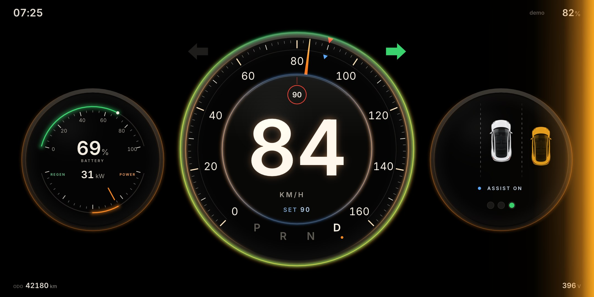

# Felina

**Category:** Rive
**File:** [`felina.riv`](felina.riv) (about 260 KB), built from [`src/`](src/)

Felina is a night-drive instrument cluster under glass. The name is Fe, Li and Na: iron for the car, lithium for the battery it reads, and sodium for the amber streetlight glow it is lit with. One big dial holds the speed: large digits in the hub, a needle with a fading light trail, the speed limit as a red mark on the scale, and the cruise set speed as a blue one. Two smaller dials sit beside it. On the left, battery charge and a power gauge that swings toward POWER or REGEN. On the right, your car seen from above, with cars in your blind spots, lane marks that pass at your speed, and the assist state. The light comes from the car's data. A traffic light floods the glass red, amber or green. The blinker throws amber light in from that side of the screen, timed to the real lamp. Over the limit, the scale between the limit mark and the needle glows hot. Regen sends energy streaming along the battery arc. When the dash starts, the dials push in, the readouts count up and the needle sweeps the whole scale before it settles.

## What it shows

| Data | How |
|---|---|
| `egoSpeed` | the big digits in the hub, and the needle on a 0 to 160 scale. It also sets how fast the lane marks pass |
| `isImperial` | KM/H or MPH under the digits |
| `fusedSpeedLimit` | the limit in a red ring above the digits and a red mark on the scale; hidden while unknown. Over it, the gap glows and a red +N appears |
| `accSetSpeed`, `adasOn` | a blue mark on the scale and SET under the digits; ASSIST ON or MANUAL in the right dial, and a cool light on the hub rim |
| `gear` | P R N D under the digits, the current one lit. In P the hub shows a large P and PARKED; in R a white reverse light rises along the bottom of the dial with REVERSE |
| `powerLevel`, `packVoltage`, `packCurrent` | the power gauge in the left dial with kW, and pack voltage in the bottom bar |
| `nominalEnergyRemaining`, `fullPackEnergy`, `energyBuffer` | battery % and the charge arc in the left dial |
| `leftBlinker`, `rightBlinker` | a green arrow beside the dial lit in step with the lamp, and amber light sweeping in from that edge, with a bulb-like afterglow |
| `leftBlindSpot`, `rightBlindSpot` | a car in the next lane in the right dial and a glow on that screen edge: amber for a vehicle, red when urgent. Shown whenever the car reports it |
| `egoSteeringAngle` | your car in the right dial turns with the wheel, and the reflection on the glass slides |
| `changingLane` | CHANGING LANE under the assist state |
| `trafficLightColor`, `stopLineDist` | three lamps in the right dial, the glass tinted the same colour, and the distance to the stop line |
| `anyDoorOpen`, `buckleStatus` | DOOR OPEN and SEATBELT in the top bar |
| `currentTime`, `phoneBattery`, `dataSourceType` | clock, phone battery (`showPhoneBattery`) and the data source in the top bar |
| `odometer` | odometer in the bottom bar (`showOdometer`) |
| `renderQuality` | the glass pass skips its bloom at the lowest setting |

The main artboard is built from layouts and tested from 1440 (4:3) to 2340 (19.5:9) units wide. The three dials live in their own `Gauges` artboard, placed with fit `scaleDown`: full size on a phone, shrunk as a whole on a tablet.

## How it is built

Everything you see is native Rive: shapes, text and data binds on `DashViewModel`. A scripted layout (`src/felina_fx.luau`) then draws a private copy of that instrument into a texture each frame and finishes it in a WGSL pass (`src/nightglass.wgsl`): bloom, glass, the needle trail and the lights listed above. While the script runs it sets `fxActive`, which hides the native copy underneath. If a runtime cannot run scripts, nothing in that layer draws and the native dash shows on its own, with every reading still live.

- `src/gen.py` writes `src/scene.rml` from `viewmodel.part`, `converters.part` and `mine.part`. One `.rml` file on purpose: a project split across several publishes script signatures the web runtime rejects.
- `src/viewmodel.part` is the `DashViewModel` from `rive/dash-demo/`, plus a few properties of my own that only the script writes (`fxActive`, `fxWidth`, `laneScroll`, `intro*`).
- Rebuild: `cd src && python3 gen.py && rive . --publish`. This writes `../felina.riv` with the two scripts signed. `rive . --once` builds without signing.

## Credits

- **Inter** font (`src/fonts/inter-400.ttf`, `inter-600.ttf`) by The Inter Project Authors, [SIL Open Font License 1.1](https://github.com/rsms/inter/blob/master/LICENSE.txt). These are the same subset files `rive/dash-demo/` already ships.
- **Car** (`src/car.png`, the top-down car in the right dial, also tinted for the blind-spot cars): made for this entry with OpenAI's image model, no reference image or third-party artwork. Released under this repository's MIT license with the rest of the entry.
- Everything else (dials, scales, needle, icons, lane marks, the shader and the start-up) is my own work in this folder. No other images, icons or sounds.
