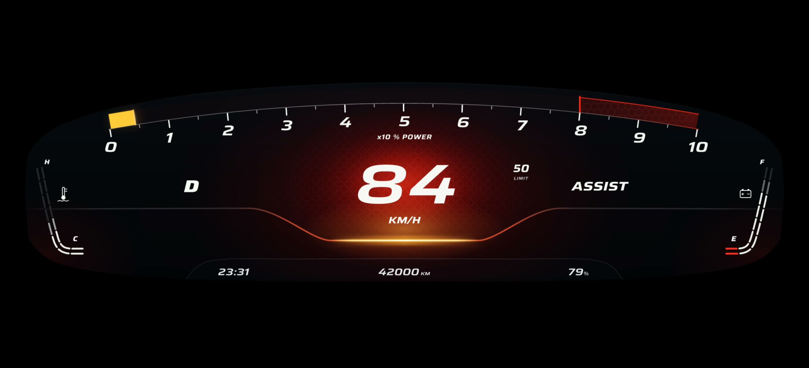

# Monte Carlo

**Category:** Rive
**File:** [`monte-carlo.riv`](monte-carlo.riv) (about 930 KB), built from [`src/`](src/)

Monte Carlo is a sports-car cluster behind one curved lens. Power runs across the top as a single ribbon from 0 to 10, with the redline marked at 8 to 10: the zone stays dark and textured until the live fill lights it. The speed sits large in the middle inside one crimson glow, with a carbon weave in the glass behind it. Gear on the left, the drive mode on the right (ASSIST or MANUAL), the posted limit beside the speed. Two narrow gauges hug the edges of the glass: battery temperature on the left, charge on the right. A quiet tab along the bottom carries the clock, the odometer and the charge in percent.

When DashPilot starts, the cluster wakes like a car's: the glass lights, the top edge and the gold dip trace out from the centre, the power ribbon sweeps to the redline and back while the scale numbers light as it passes, then everything settles onto the live readings in about two seconds.

## What it shows

| Data | How |
|---|---|
| `egoSpeed` | the big number in the crimson glow. Drive over the limit and the glass heats red |
| `powerLevel` | the power ribbon across the top, 0 to 10 (x10 % power), with a bright head on its leading edge. Negative power is regen: a short teal fill runs left of 0 |
| `fusedSpeedLimit` | the posted limit beside the speed, hidden while unknown |
| `gear` | the gear letter left of the speed |
| `adasOn` | ASSIST in white or MANUAL in grey, right of the speed. The outgoing word hides at once and the new one fades in, so they never overlap |
| `leftBlinker`, `rightBlinker` | an amber arrow above the gauges on that side, lit in step with the lamp |
| `leftBlindSpot`, `rightBlindSpot` | the lens tip on that side glows amber for a car in your blind spot, red when it is urgent |
| `trafficLightColor` | a small lamp under the limit, lit red, yellow or green |
| `packTMax` | the left edge gauge, C to H |
| `nominalEnergyRemaining`, `fullPackEnergy`, `energyBuffer` | the right edge gauge, E to F, with a red dash when the charge runs low, and the percentage in the bottom tab |
| `odometer`, `currentTime` | the bottom tab |
| `renderQuality` | the lens pass skips its bloom at the lowest setting |

The instrument keeps its 2280 x 1080 design and scales to fit the screen (contain), centred. Speed is shown in km/h. There is no mph switch.

## How it is built

The lens, the ribbon, the numbers, the gauges and every data bind on `DashViewModel` are native Rive. A scripted layout (`src/v3_fx.luau`) draws a private copy of the instrument into a texture each frame and finishes it in a WGSL pass (`src/lensfx.wgsl`): the bloom, the head of the power ribbon, the redline heat and the start-up. The script also writes a few numbers of its own into the view model (`intro*`, `displayPower`) that drive the start-up and one smoothed power value both layers share. While it runs it sets `fxActive`, which hides the native copy underneath. If a runtime cannot run GPU Canvas, nothing in that layer draws and the native dash shows on its own, every reading still live. In DashPilot on Android the GPU layer needs a worker that supports GPU Canvas, which is what softwiredtech/dashpilot#267 turns on.

- `src/v3.py` writes `src/scene.rml` from `viewmodel.part`, `converters.part`, `mine.part` and `v3.part`, using the helpers in `src/gen.py`. One `.rml` file on purpose: a project split across several publishes script signatures the web runtime rejects.
- `src/viewmodel.part` is the `DashViewModel` from `rive/dash-demo/`, plus the properties of my own that only the script writes.
- Rebuild: `cd src && python3 v3.py && rive . --publish`. This writes `../monte-carlo.riv` with the scripts signed. `rive . --once` builds without signing.

Tested in DashPilot on Android (OnePlus 12R, 2780×1264 landscape) with the Demo data source: with GPU Canvas on (softwiredtech/dashpilot#267, Settings > Developer) the lens pass renders live, and with it off the native dash shows every reading. Also checked in the Rive web runtime with a simulated drive that sends the same values Demo mode does.

## Credits

- **Saira** font (`src/fonts/saira-italic-sub.ttf`, a subset of Saira Italic) by The Saira Project Authors, [SIL Open Font License 1.1](src/fonts/OFL-Saira.txt). It sets the speed, the gear, the mode and the scale.
- **Exo 2** font (`src/fonts/exo2-*.ttf`) by The Exo 2 Project Authors, [SIL Open Font License 1.1](src/fonts/OFL-Exo2.txt).
- **Inter** font (`src/fonts/inter-400.ttf`, `inter-600.ttf`) by The Inter Project Authors, [SIL Open Font License 1.1](https://github.com/rsms/inter/blob/master/LICENSE.txt). These are the same files `rive/dash-demo/` already ships.
- Everything else (the lens, the ribbon, the gauges, the glow and weave, the icons, the shader and the start-up) is my own work in this folder. No images and no sounds.
