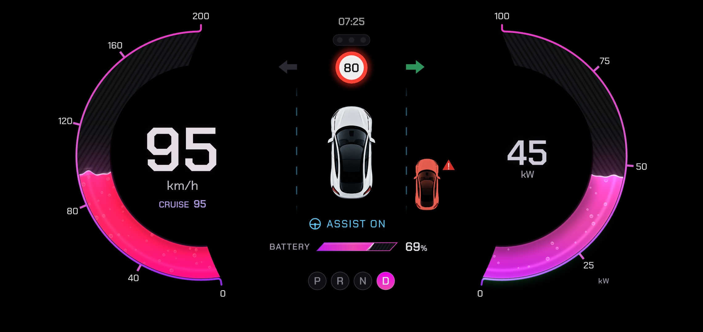

# Parabellum

**Category:** Rive
**File:** [`parabellum.riv`](parabellum.riv) (about 680 KB), built from [`src/`](src/)

Parabellum is an instrument cluster poured from liquid: pink neon through glass. The name is Latin for "prepare for war". Two open ribbons curve around the car like glass tubes. Speed is on the left, 0 to 200 km/h. Power is on the right, in kW. The liquid in each tube rises with the reading and tilts and sloshes when the reading changes fast. Bubbles rise through it, and a bright line rides the surface. Drive over the limit and the speed liquid boils and runs hot red while the limit sign burns. Brake into regen and the power liquid turns lavender and flows the other way, with REGEN under the kW. The two big numbers stay still at a steady speed. They pulse on every change, glow pink while you accelerate and cool to lavender when you brake or regenerate. Between the ribbons your car is seen from above with lane marks passing at your speed, blue while driver assist is on. The limit sign, a traffic light, the neighbour in your blind spot, the battery and the gear sit on the same centre line.

## What it shows

| Data | How |
|---|---|
| `egoSpeed` | the big number on the left and the liquid level in the left ribbon. It also sets how fast the lane marks pass (backwards in reverse) and how much the liquid sloshes |
| `fusedSpeedLimit` | the limit sign above the car, hidden while unknown. Over the limit the speed liquid boils and runs red and the sign burns red |
| `accSetSpeed`, `adasOn` | CRUISE and the set speed under km/h (greyed to SET while you override it); ASSIST ON with a steering wheel icon, and the lane marks turn blue |
| `packVoltage`, `packCurrent` | kW (volts times amps) as the big number on the right and the power ribbon, 0 to 100 kW. Negative power is regen: the liquid turns lavender and REGEN appears |
| `nominalEnergyRemaining`, `fullPackEnergy`, `energyBuffer` | battery percentage and the slanted battery bar, which turns red when the charge runs low (about 20 %) |
| `gear` | P R N D chips with the current one lit. In R the lane marks run backwards |
| `leftBlinker`, `rightBlinker` | a green arrow beside the car, lit in step with the lamp, and a green light running along that ribbon's rim |
| `leftBlindSpot`, `rightBlindSpot` | a car in the next lane on that side, amber for a vehicle and red with a warning mark when urgent |
| `trafficLightColor` | three lamps under the clock, lit red, yellow or green |
| `currentTime` | the clock at the top |
| `renderQuality` | the glass pass skips its bloom at the lowest setting |

The instrument keeps its 2280 x 1080 design and scales to fit the screen (contain), centred. Speed is shown in km/h and power in kW. There is no mph switch.

When DashPilot starts with the car parked, both ribbons pour full and then drain to the real reading in about two seconds. Moving cancels it.

## How it is built

The ribbons, numbers, car, signs and every data bind on `DashViewModel` are native Rive. A scripted layout (`src/ribbon_fx.luau`) draws a private copy of that instrument into a texture each frame and finishes it in a WGSL pass (`src/ribbonglass.wgsl`): the liquid, its bubbles, the glow and the lane marks. While the script runs it sets `fxActive`, which hides the native copy underneath. If a runtime cannot run GPU Canvas, nothing in that layer draws and the native dash shows on its own: flat ribbons, every reading still live. In DashPilot on Android the GPU layer needs a worker that supports GPU Canvas, which is what softwiredtech/dashpilot#267 turns on.

The two big numbers get their glow from the same script. It writes six numbers of its own into the view model (`spdHot`, `spdCool`, `spdPunch`, `kwHot`, `kwCool`, `kwPunch`) that fade a tinted copy of each number in and scale it a little. Without scripts they stay at their calm defaults, so the number is plain white.

- `src/ribbon.py` writes `src/scene.rml` from `viewmodel.part`, `converters.part`, `mine.part` and `ribbon.part`, using the helpers in `src/gen.py`. One `.rml` file on purpose: a project split across several publishes script signatures the web runtime rejects.
- `src/viewmodel.part` is the `DashViewModel` from `rive/dash-demo/`, plus a few properties of my own that only the script writes (`fxActive`, `laneScroll`, `intro*` and the six above).
- Rebuild: `cd src && python3 ribbon.py && rive . --publish`. This writes `../parabellum.riv` with the scripts signed. `rive . --once` builds without signing.

Tested in DashPilot on Android (OnePlus 12R, 2780×1264 landscape) with the Demo data source: with GPU Canvas on (softwiredtech/dashpilot#267, Settings > Developer) the liquid layer renders live, and with it off the native dash shows every reading. Also checked in the Rive web runtime with a simulated drive that sends the same values Demo mode does.

## Credits

- **Chakra Petch** font (`src/fonts/chakrapetch-500.ttf`, `chakrapetch-600.ttf`) by The Chakra Petch Project Authors, [SIL Open Font License 1.1](src/fonts/OFL-ChakraPetch.txt). It sets every number and label.
- **Inter** font (`src/fonts/inter-400.ttf`, `inter-600.ttf`) by The Inter Project Authors, [SIL Open Font License 1.1](https://github.com/rsms/inter/blob/master/LICENSE.txt). These are the same files `rive/dash-demo/` already ships.
- **Car** (`src/car.png`, the top-down car in the middle, also tinted for the blind-spot car): generated for this entry with OpenAI's image model. It contains no photograph and no logo.
- Everything else (the ribbons, liquid, bubbles, numbers, scales, icons, lane marks, the shader and the start-up) is my own work in this folder. No other images, icons or sounds.
